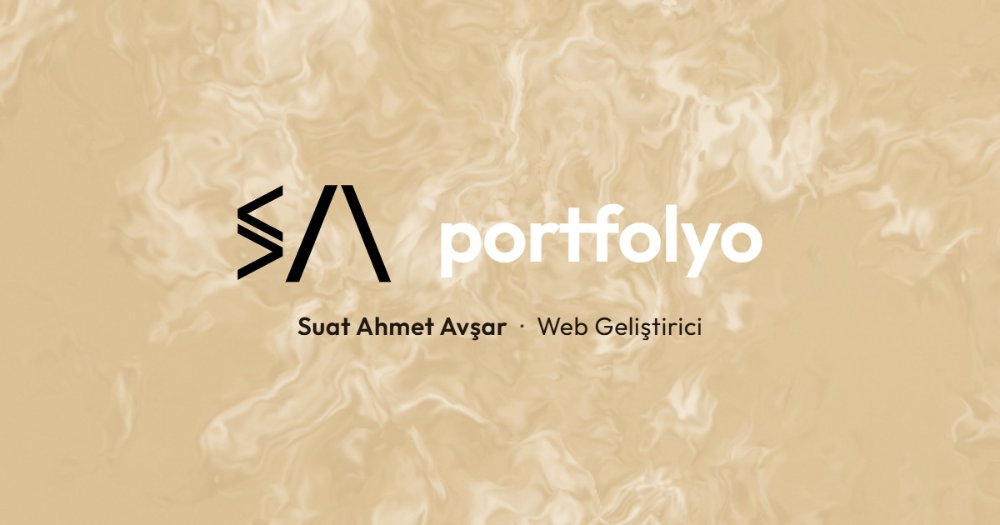

# Portfolyo — Suat Ahmet Avşar

Kişisel web geliştirici portfolyom. Kum tonlu, animasyonlu, tek sayfalık statik bir site.

**Canlı site:** https://suatahmetportfolyo.netlify.app/



## Öne çıkanlar

- **Animasyonlu arka plan:** WebGL ile çizilen duman/ışık efekti (`light.js`). Yavaş cihazlarda çözünürlüğü kendiliğinden düşürür.
- **Dönen 3D laptop:** Giriş bölümünde Three.js ile çizilen laptop modeli (`laptop3d.js`).
- **Silindir proje vitrini:** Projeler, kameranın etrafında dönen kavisli kartlar olarak gösterilir. Karta tıklayınca aynı sayfada detay katmanı açılır (`showcase.js`).
- **3D kariyer kitabı:** Kaydırdıkça sayfaları çevrilen bir kitap (`book3d.js`). Telefonda yazılar büyütülüp yeni yapraklara dağıtılır.
- **Telefon desteği:** Özel parmakla kaydırma (`touch-scroll.js`), yatay kart kaydırma ve dikey kullanım uyarısı.
- **Düşük donanım modu:** Zayıf cihazlarda 3D sahneler hafifletilir. Adrese `?low` ekleyerek denenebilir.

## Teknolojiler

- HTML, CSS, düz JavaScript (derleme adımı yok)
- [Three.js](https://threejs.org/) 0.169 (CDN üzerinden)
- WebGL shader
- Playwright (testler)
- Netlify (yayın)

## Dosya yapısı

| Dosya | Görevi |
| --- | --- |
| `index.html` | Sayfa iskeleti |
| `style.css` | Tüm stiller |
| `data.js` | Site içeriği (isim, projeler, kariyer, iletişim). **İçerik değişiklikleri burada yapılır.** |
| `render.js` | `data.js` içeriğini sayfaya yerleştirir |
| `script.js` | Yükleme ekranı ve genel kaydırma davranışları |
| `light.js` | WebGL arka plan |
| `laptop3d.js` | 3D laptop sahnesi |
| `book3d.js` | 3D kariyer kitabı |
| `showcase.js` | Silindir proje vitrini ve detay katmanı |
| `contact-title.js` | İletişim başlığı animasyonu |
| `touch-scroll.js` | Telefonda kaydırma |
| `yayin-hazirla.js` | Yayın klasörünü (`yayin/`) hazırlar |
| `tests/` | Playwright testleri |

## Yerelde çalıştırma

[Node.js](https://nodejs.org/) kurulu olmalı.

```bash
npm start
```

Ardından tarayıcıda http://localhost:5500 adresini açın.

> Not: `index.html` dosyasını çift tıklayarak açmak yeterli değildir. 3D modeller ve modüller bir sunucu üzerinden yüklenmelidir.

## Yayınlama

```bash
npm run yayin
```

Bu komut yalnızca yayında gereken dosyaları `yayin/` klasörüne kopyalar. Bu klasör Netlify'a sürüklenip bırakılarak yayınlanır.

## Testler

```bash
npm install
npx playwright install chromium
npm test
```

## Atıflar

- 3D laptop modeli: ["Modern Slim Laptop"](https://sketchfab.com/3d-models/modern-slim-laptop-fbf172f8b14241feab581dcb1fbcd475), [Blaž Mraz](https://sketchfab.com/Mraz3D), [CC BY 4.0](https://creativecommons.org/licenses/by/4.0/) lisansıyla. Animasyon için ekran malzemesi uyarlanmıştır.

## Lisans

© Suat Ahmet Avşar. Tüm hakları saklıdır. Kod incelemek ve fikir almak için paylaşılmıştır. Tasarımı ve içeriği izin almadan kopyalamayın.
